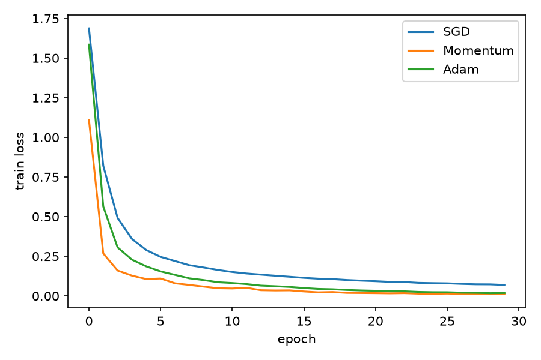
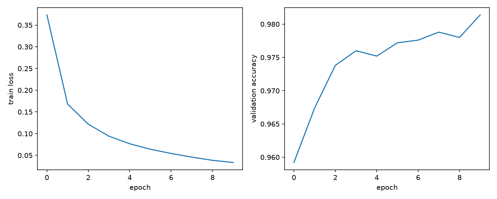

# Neural Network from Scratch (NumPy)

A multi-layer perceptron built with only NumPy: forward pass, backpropagation, and three optimizers (SGD, Momentum, Adam). Backprop is verified with numerical gradient checking.

## Files
- `nn.py` - the library (Dense, ReLU, softmax cross-entropy, SGD/Momentum/Adam, MLP.fit)
- `grad_check.py` - compares backprop gradients to finite differences
- `train_xor.py` - XOR sanity check
- `train_digits.py` - handwritten digits, compares optimizers

## Run
    pip install numpy scikit-learn matplotlib
    python grad_check.py
    python train_xor.py
    python train_digits.py

## Results (8x8 digits, 64-64-10 network, 30 epochs)
| Optimizer | Test accuracy |
|-----------|---------------|
| SGD       | 96.7% |
| Momentum  | 97.8% |
| Adam      | 97.8% |

Gradient check: max relative error 1.33e-08 (backprop matches numerical gradients).

The test set has 360 images, so differences of about 1% are within noise. Learning rates were not tuned per optimizer, so this is not a claim that one optimizer is better in general.

## Math
- Layer: y = xW + b; ReLU: max(0, x)
- Softmax cross-entropy gradient with respect to logits: (p - y) / N
- Backprop: dW = x^T * dy, db = sum(dy), dx = dy * W^T

## Possible next steps
- Train on full MNIST (28x28)
- Add dropout and L2 regularization
- Learning-rate schedule
## Results on full MNIST (28x28)
784-128-10 network, Adam (lr 1e-3), batch size 128, 10 epochs, about 55 s on a laptop CPU.

| Split | Accuracy |
|-------|----------|
| Validation (5,000 held out from train) | 98.1% |
| Test (10,000 images, evaluated once) | 97.8% |

Run: `python train_mnist.py` (needs `pandas`; the first run downloads MNIST).